 

### ✦ About Me | 소개

**데이터를 통해 가치 있는 변화를 만듭니다.**  
경북소프트웨어마이스터고등학교 2학년 데이터 분석가 지망생 유채민입니다.

데이터를 탐색하고 패턴을 발견하며,  
분석을 통해 실제 문제를 해결하는 과정에 관심이 있습니다.

**Creating meaningful change through data.**  
I'm Yoo Chaemin, a second-year student at Gyeongbuk Software Meister High School and an aspiring Data Analyst.

I'm passionate about exploring data, discovering patterns, and solving real-world problems through data-driven analysis.

`Data Analytics` · `Machine Learning` · `Data Visualization`

 

---

### ✦ Tech Stack | 기술 스택

**Languages**

 

**Data Analysis Libraries**

 

**Development & Tools**

---

### ✦ Featured Projects | 주요 프로젝트

| Project | Description | Keywords |
|:---:|:---|:---|
| ⚽ **FIFA Player Value Prediction** | FIFA 선수 데이터를 활용한 시장가치 예측 및 회귀분석 | `Regression` `Python` `ML` |
| 🧠 **Brain Tumor Analysis** | 딥러닝 기반 뇌종양 의료 영상 분석 | `Deep Learning` `Medical Imaging` |
| 🛍️ **E-Commerce Data Analysis** | 이커머스 고객 행동 데이터 탐색 및 분석 | `EDA` `Pandas` `Visualization` |

 

---

### ✦ Contribution Snake | GitHub 활동

<picture>
  <source
    media="(prefers-color-scheme: dark)"
    srcset="https://raw.githubusercontent.com/chxe01/chxe01/output/github-contribution-grid-snake-dark.svg"
  />
  <source
    media="(prefers-color-scheme: light)"
    srcset="https://raw.githubusercontent.com/chxe01/chxe01/output/github-contribution-grid-snake.svg"
  />
  
</picture>

 

---

### ✦ Thanks for Visiting!

시간 내어 저의 포트폴리오를 읽어주셔서 감사합니다.  
궁금한 점이 있다면 아래로 연락주세요!

Thank you for taking the time to explore my portfolio.  
If you have any questions, please feel free to contact me using the links below!

  
  
  

